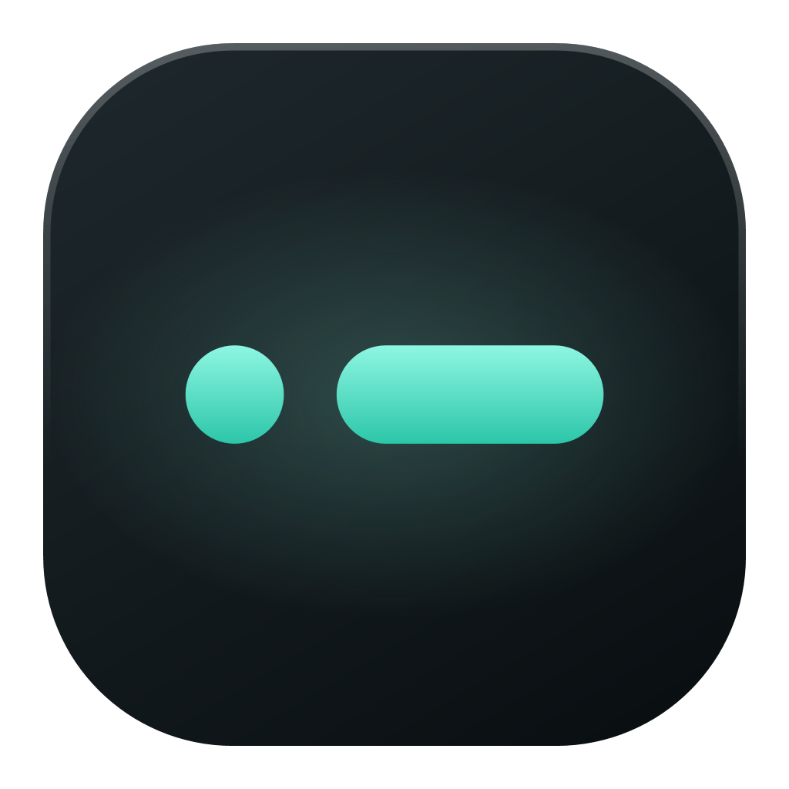
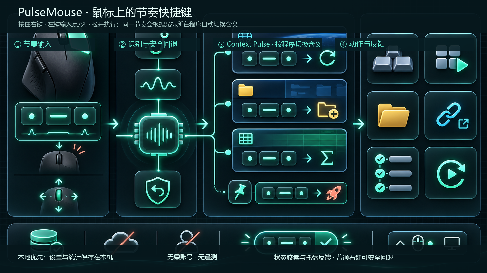
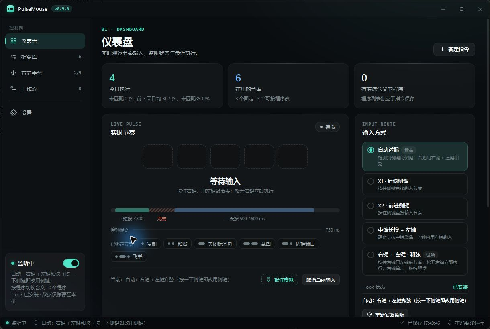
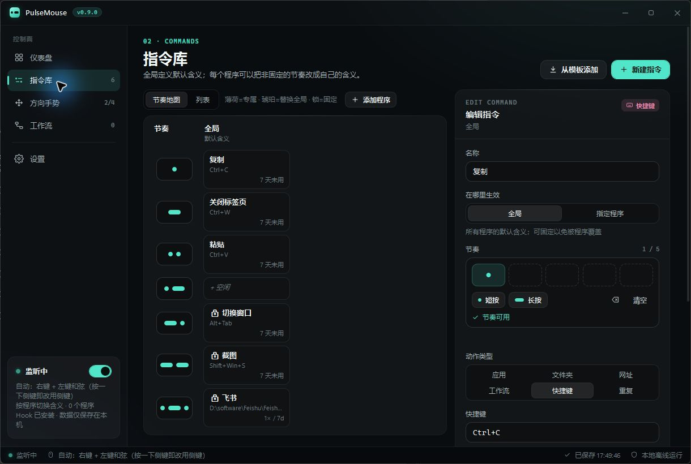
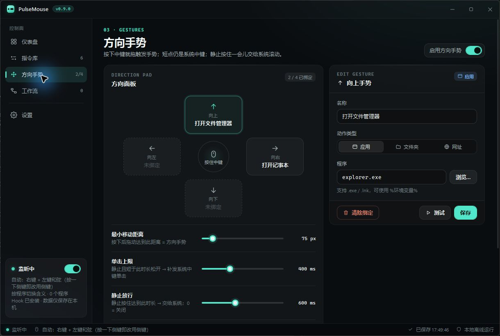
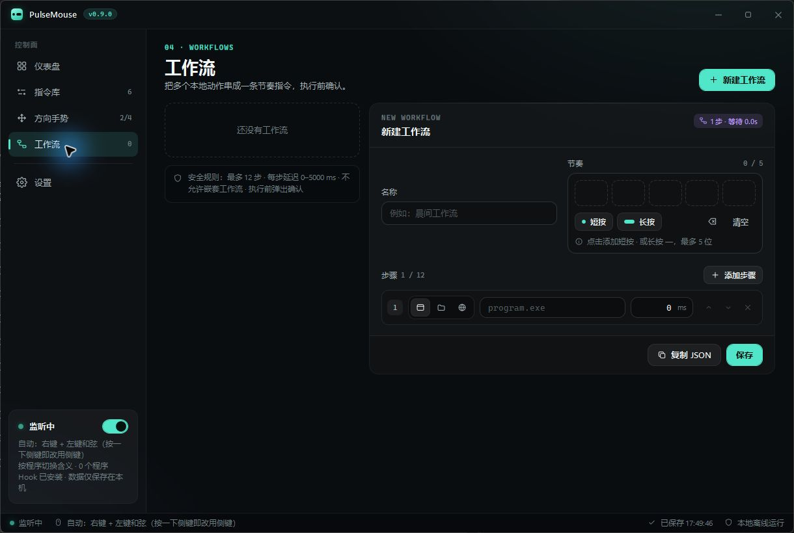
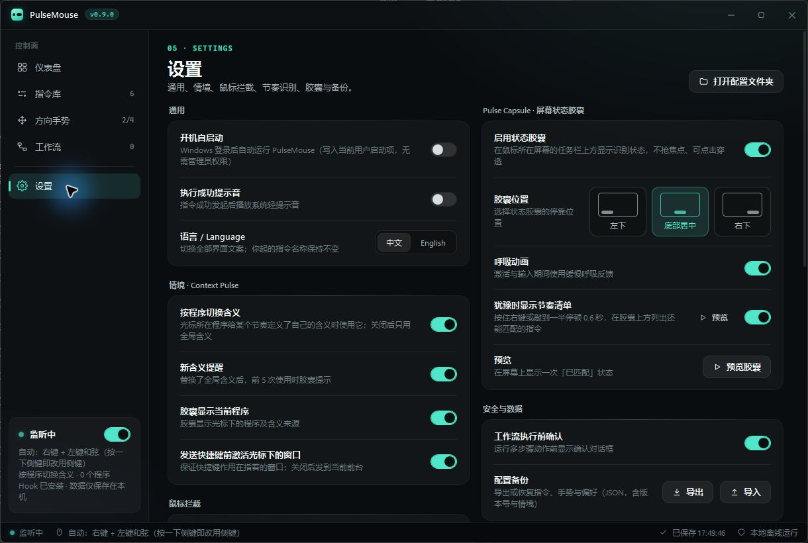

<p align="center">
  
</p>

<h1 align="center">PulseMouse</h1>

<p align="center">
  <strong>Mouse-first rhythm shortcuts for Windows.</strong><br>
  Hold, tap a short dot/dash rhythm, and release—without moving the pointer or opening a menu.
</p>

<p align="center">
  <a href="https://github.com/chnjames/PulseMouse/releases/tag/v0.9.0"><strong>Download v0.9.0</strong></a>
  · <a href="README.zh-CN.md">简体中文</a>
  · <a href="docs/DEVELOPMENT.md">Development</a>
  · <a href="docs/ARCHITECTURE.md">Architecture</a>
</p>

<p align="center">
  
  
  
  
</p>

<p align="center">
  <a href="https://github.com/chnjames/PulseMouse/releases/download/v0.9.0/PulseMouse-v0.9.0-win-x64.zip">Windows x64 portable ZIP</a>
  · <a href="https://github.com/chnjames/PulseMouse/releases/download/v0.9.0/PulseMouse-v0.9.0-win-x64.zip.sha256">SHA-256</a>
</p>



> **Pre-release notice.** v0.9.0 ships as a portable Windows x64 build. It has no installer, code signature, or automatic updater yet. Core smoke tests pass; global-hook, injected-input, target-window, and display-scaling behavior still require the manual checks in the [release checklist](docs/RELEASE_CHECKLIST.md).

## Why PulseMouse?

Launchers help you find an action. PulseMouse is for the small set of actions you already know by heart—copy, screenshot, switch window, open a tool, or send a shortcut. It makes those actions available through a compact rhythm while your cursor and attention stay on the current task.

## From mouse rhythm to action

| 1. Hold the trigger | 2. Tap a rhythm | 3. Release to act |
| --- | --- | --- |
| In automatic mode, PulseMouse uses a detected side button or falls back to right-click + left-click. | A quick left press is a `.` dot; a 500–1600 ms hold is a `-` dash. | PulseMouse resolves the rhythm for the window under the pointer, then executes the matching action. |

The same rhythm can mean different things in a browser, File Explorer, or a spreadsheet. Pinned global mappings always win; ordinary right-clicks and right-dragging return to their native behavior when no rhythm is completed.

## See it in action

<p align="center">
  
</p>

| Command library | Direction gestures |
| --- | --- |
|  |  |

| Workflow builder | Settings and safety controls |
| --- | --- |
|  |  |

All interface captures above are from the running `v0.9.0` application. The feature-and-architecture overview is an explanatory visual, not a UI screenshot.

## Highlights

| | Capability | What it gives you |
| --- | --- | --- |
| ◌—◌ | **Fast rhythm input** | Enter up to five dot/dash pulses and release to run a mapping immediately. |
| ⌁ | **Context Pulse** | Reuse one rhythm with a different meaning in Chrome, Explorer, Excel, or another app. |
| ↗ | **Useful actions** | Launch an app or folder, open an HTTPS URL, send a shortcut, run a confirmed workflow, or repeat the last successful action. |
| ✥ | **Direction gestures** | Hold middle-click and drag up, down, left, or right to invoke a separate action layer. |
| ◉ | **Feedback without focus theft** | Use an on-screen capsule, reachable-rhythm hints, tray state, diagnostics, and local statistics. |
| ⌂ | **Local by design** | Keep settings and statistics in `%LOCALAPPDATA%\PulseMouse\settings.json`; no account or telemetry. |

## Download and run

> **For Windows 10/11 x64.** This is a portable pre-release build.

1. Download [PulseMouse-v0.9.0-win-x64.zip](https://github.com/chnjames/PulseMouse/releases/download/v0.9.0/PulseMouse-v0.9.0-win-x64.zip).
2. Extract **all** files to a folder you control.
3. Run `PulseMouse.exe`.

The ZIP includes required WPF native files alongside the executable. Verify it with the published [SHA-256 file](https://github.com/chnjames/PulseMouse/releases/download/v0.9.0/PulseMouse-v0.9.0-win-x64.zip.sha256) if needed. Because the build is unsigned, Windows may show a SmartScreen warning.

## First five minutes

1. Start PulseMouse and confirm the dashboard reports that the hook is installed.
2. Add three to eight mappings that you use every day; begin with short rhythms.
3. In automatic mode, use a side button when one is detected. Otherwise, hold right-click and tap with left-click.
4. Release the trigger to execute; scroll during a right-click chord to cancel.

### Rhythm rules

| Input | Meaning |
| --- | --- |
| Quick press, up to 300 ms | `.` dot |
| Hold, 500–1600 ms | `-` dash |
| 300–500 ms, below 35 ms, or over 1600 ms | rejected |

Right-click chords commit on release. Side-button and classic middle-button modes commit after a 750 ms pause.

## Actions and Context Pulse

PulseMouse records the window under the pointer when the trigger starts. Resolution is deterministic:

1. A pinned global mapping wins.
2. An app-specific mapping wins when Context Pulse is enabled.
3. Otherwise the global mapping runs.

| Action | Notes |
| --- | --- |
| Application | `.exe`, `.lnk`, or a command name; environment variables are expanded. |
| Folder | Opens an existing folder. |
| URL | HTTP and HTTPS only. |
| Shortcut | Examples: `Ctrl+C`, `Alt+Tab`, `Shift+Win+S`. |
| Workflow | 1–12 application, folder, or URL steps; confirmation is on by default. |
| Repeat last action | Replays the most recent successful non-workflow action. |
| Direction gesture | Middle-click drag: up, down, left, or right. |

The desktop and taskbar intentionally use global mappings only. Shortcut actions can activate the captured target window before sending input; if the target is gone or cannot be activated, the shortcut is not sent.

## Safety and limitations

- PulseMouse uses a global mouse hook and `SendInput`; do not use it with games or anti-cheat-protected software.
- A non-elevated instance cannot reliably inject input into elevated applications.
- Touchpads generally cannot perform the right-click + left-click chord comfortably.
- Unsigned pre-release builds may trigger security warnings.

Read [SECURITY.md](SECURITY.md) for responsible disclosure and [docs/RELEASE_CHECKLIST.md](docs/RELEASE_CHECKLIST.md) for the manual validation gate.

## Build from source

Requirements: Windows 10/11 and the .NET 10 SDK.

```powershell
dotnet restore PulseMouse.slnx
dotnet build PulseMouse.slnx -c Release --no-restore
dotnet run --project tests/PulseMouse.Core.SmokeTests -c Release --no-build
```

Run `./build-windows.ps1` for a self-contained x64 publish at `publish/win-x64/`.

## Documentation

- [Architecture](docs/ARCHITECTURE.md)
- [Development guide](docs/DEVELOPMENT.md)
- [Product roadmap](docs/PRODUCT_ROADMAP.md)
- [v0.9 implementation specification](docs/V0_9_CONTEXT_PULSE_SPEC.md)
- [Changelog](CHANGELOG.md)

## Contributing and license

Issues and pull requests are welcome. Read [CONTRIBUTING.md](CONTRIBUTING.md) before proposing a change. PulseMouse is released under the [MIT License](LICENSE).
