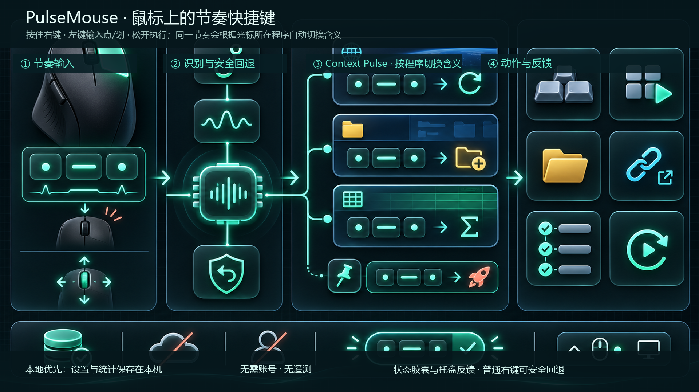

<p align="center">
  
</p>

<h1 align="center">PulseMouse</h1>

<p align="center">
  <strong>Windows 上的鼠标节奏快捷键。</strong><br>
  按住、敲一段点划节奏、松开执行；不用移动光标，也不用打开菜单。
</p>

<p align="center">
  <a href="https://github.com/chnjames/PulseMouse/releases/tag/v0.9.0"><strong>下载 v0.9.0</strong></a>
  · <a href="README.md">English</a>
  · <a href="docs/DEVELOPMENT.md">开发说明</a>
  · <a href="docs/ARCHITECTURE.md">架构说明</a>
</p>

<p align="center">
  
  
  
  
</p>

<p align="center">
  <a href="https://github.com/chnjames/PulseMouse/releases/download/v0.9.0/PulseMouse-v0.9.0-win-x64.zip">Windows x64 便携包</a>
  · <a href="https://github.com/chnjames/PulseMouse/releases/download/v0.9.0/PulseMouse-v0.9.0-win-x64.zip.sha256">SHA-256</a>
</p>



> **预发布说明。** v0.9.0 提供 Windows x64 便携版；暂未提供安装器、代码签名与自动更新。Core 冒烟测试已通过；全局鼠标钩子、模拟输入、目标窗口激活和显示缩放仍须按 [真机验收清单](docs/RELEASE_CHECKLIST.md) 完成验证。

## 它解决什么问题？

启动器和菜单擅长“找动作”；PulseMouse 面向你已经熟记的少量高频操作：复制、截图、切换窗口、打开工具或发送快捷键。它让鼠标停在原处，把注意力留在当前任务上。

## 从鼠标节奏到动作

| 1. 按住触发键 | 2. 输入节奏 | 3. 松开执行 |
| --- | --- | --- |
| 自动模式优先使用已检测到的侧键；没有侧键时，使用右键按住 + 左键敲击。 | 左键快速按下是 `.` 点；按住 500–1600 ms 是 `-` 划。 | PulseMouse 根据光标下的窗口解析节奏，并执行对应动作。 |

同一节奏可以在浏览器、资源管理器和表格里代表不同动作。固定的全局指令始终优先；未完成节奏时，普通右键和右键拖拽会回到原生行为。

## 真实界面

<p align="center">
  
</p>

| 指令库 | 方向手势 |
| --- | --- |
|  |  |

| 工作流编辑器 | 设置与安全控制 |
| --- | --- |
|  |  |

以上均为正在运行的 `v0.9.0` 应用实机截图。功能与架构总览用于解释产品链路，不是界面截图。

## 核心能力

| | 能力 | 你能得到什么 |
| --- | --- | --- |
| ◌—◌ | **快速节奏输入** | 最多输入 5 位点划节奏，松开立即执行映射。 |
| ⌁ | **Context Pulse** | 在 Chrome、资源管理器、Excel 或其他程序中，让同一节奏拥有不同含义。 |
| ↗ | **实用动作** | 打开程序/文件夹/HTTPS 网址、发送快捷键、执行需确认的工作流，或重复上一次成功动作。 |
| ✥ | **方向手势** | 按住中键向上、下、左、右拖动，使用独立的动作层。 |
| ◉ | **不抢焦点的反馈** | 使用状态胶囊、可达节奏提示、托盘状态、诊断和本地统计。 |
| ⌂ | **本地优先** | 设置与统计保存在 `%LOCALAPPDATA%\PulseMouse\settings.json`；无账号、无遥测。 |

## 下载并运行

> **适用于 Windows 10/11 x64。** 当前为便携预发布版。

1. 下载 [PulseMouse-v0.9.0-win-x64.zip](https://github.com/chnjames/PulseMouse/releases/download/v0.9.0/PulseMouse-v0.9.0-win-x64.zip)。
2. 解压**全部**文件到你可管理的目录。
3. 运行 `PulseMouse.exe`。

压缩包包含可执行文件及所需的 WPF 原生文件。如有需要，可通过发布页的 [SHA-256 文件](https://github.com/chnjames/PulseMouse/releases/download/v0.9.0/PulseMouse-v0.9.0-win-x64.zip.sha256) 校验完整性。未签名的预发布程序可能触发 Windows SmartScreen 提示。

## 前五分钟

1. 启动 PulseMouse，确认仪表盘显示 Hook 已安装。
2. 先绑定 3–8 个每天都会用到的动作，优先使用短节奏。
3. 自动模式会优先使用已检测到的侧键；没有侧键时，按住右键后用左键输入。
4. 松开触发键执行；在右键和弦中滚动滚轮可取消本次输入。

### 节奏规则

| 输入 | 含义 |
| --- | --- |
| 快速按下，最多 300 ms | `.` 点 |
| 按住 500–1600 ms | `-` 划 |
| 300–500 ms、少于 35 ms、超过 1600 ms | 本次脉冲无效 |

右键和弦在松开时提交；侧键与经典中键模式在停顿 750 ms 后提交。

## 动作与 Context Pulse

PulseMouse 在按下触发键时记录光标下的窗口，并按固定顺序解析指令：

1. 固定的全局指令优先；
2. 启用 Context Pulse 时，使用该程序的专属指令；
3. 否则使用全局指令。

| 动作 | 说明 |
| --- | --- |
| 程序 | `.exe`、`.lnk` 或命令名，支持环境变量。 |
| 文件夹 | 打开已存在的目录。 |
| 网址 | 仅支持 HTTP / HTTPS。 |
| 快捷键 | 例如 `Ctrl+C`、`Alt+Tab`、`Shift+Win+S`。 |
| 工作流 | 1–12 步程序、文件夹或网址；默认执行前确认。 |
| 重复上一次 | 重放最近一次成功的非工作流动作。 |
| 方向手势 | 按住中键向上、下、左、右拖动。 |

桌面与任务栏只使用全局指令。快捷键可先激活捕获到的目标窗口；若目标不存在或无法激活，则不会发送该快捷键。

## 安全与限制

- PulseMouse 使用全局鼠标钩子和 `SendInput`；请不要在游戏或带反作弊保护的软件中使用。
- 普通权限的 PulseMouse 无法可靠地向管理员权限窗口注入输入。
- 触控板通常不适合右键按住 + 左键敲击的和弦输入。
- 未签名的预发布版本可能触发安全软件或系统提示。

请阅读 [SECURITY.md](SECURITY.md) 了解漏洞报告方式，并按 [docs/RELEASE_CHECKLIST.md](docs/RELEASE_CHECKLIST.md) 完成真机验收。

## 从源码构建

环境：Windows 10/11 与 .NET 10 SDK。

```powershell
dotnet restore PulseMouse.slnx
dotnet build PulseMouse.slnx -c Release --no-restore
dotnet run --project tests/PulseMouse.Core.SmokeTests -c Release --no-build
```

运行 `./build-windows.ps1` 可生成自包含 x64 发布产物到 `publish/win-x64/`。

## 文档

- [架构说明](docs/ARCHITECTURE.md)
- [开发说明](docs/DEVELOPMENT.md)
- [产品路线图](docs/PRODUCT_ROADMAP.md)
- [v0.9 实现规格](docs/V0_9_CONTEXT_PULSE_SPEC.md)
- [更新记录](CHANGELOG.md)

## 贡献与许可证

欢迎提交 Issue 与 Pull Request。开始前请阅读 [CONTRIBUTING.md](CONTRIBUTING.md)。本项目采用 [MIT License](LICENSE)。
