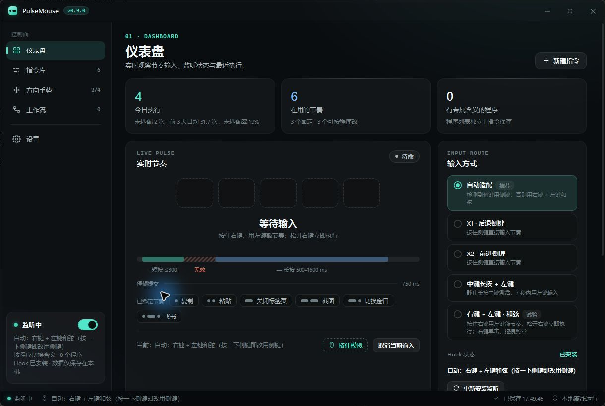
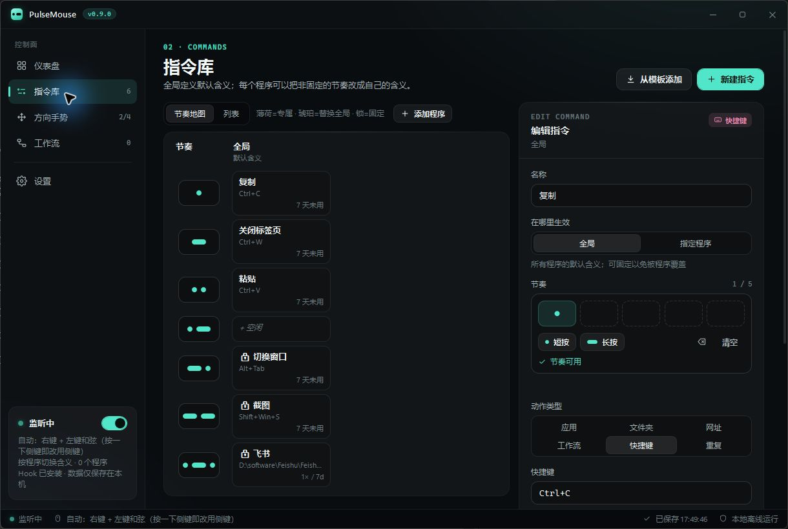
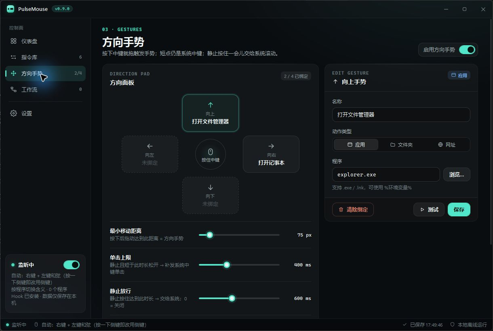
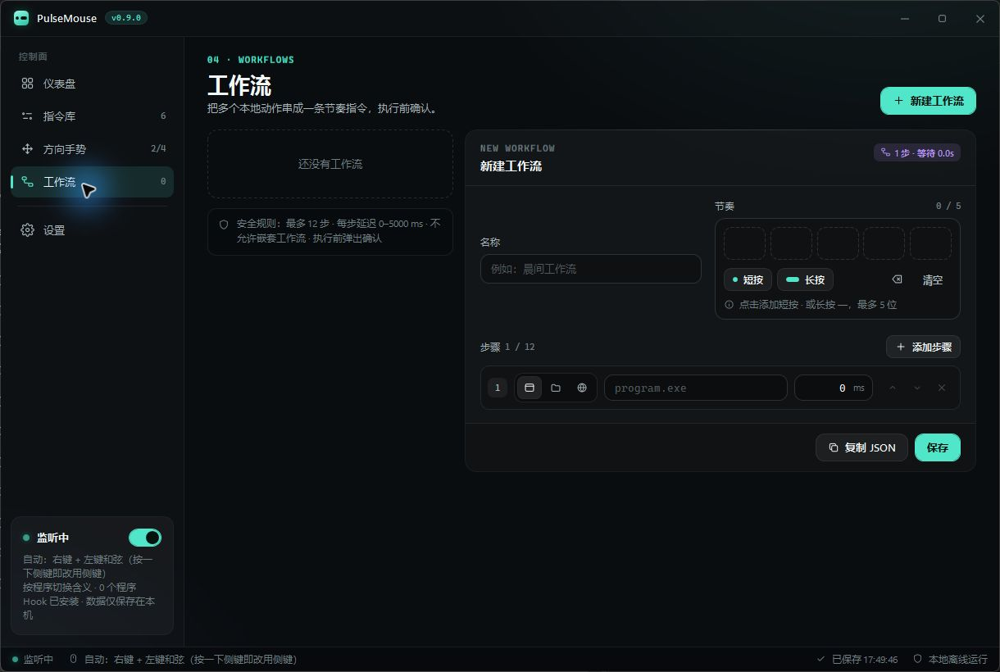
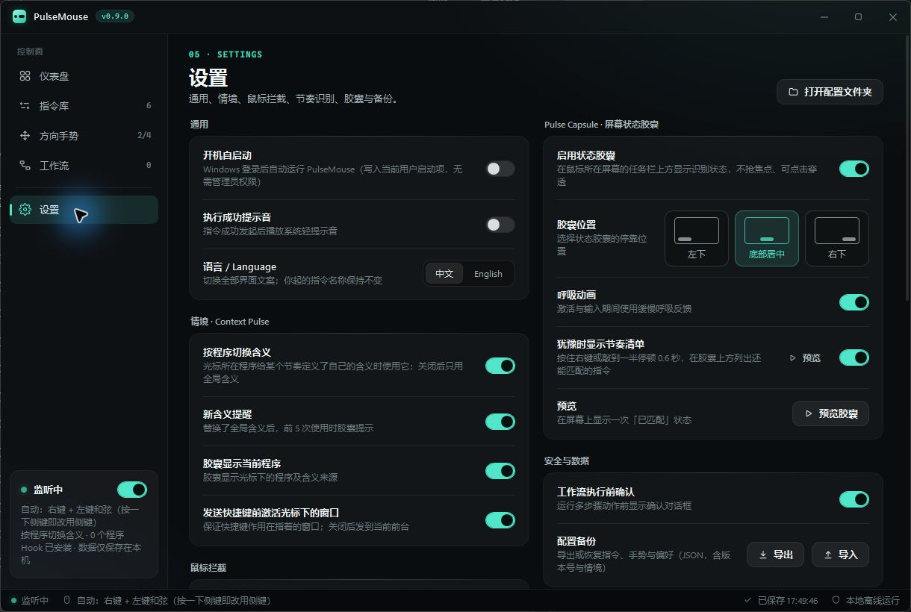

# PulseMouse

<p align="center">
  
</p>

**Windows 上的鼠标快捷键。** 按住右键，用左键敲一小段节奏，松开即可执行高频操作；光标不必移动，也不用打开菜单。

[English](README.md) · [架构](docs/ARCHITECTURE.md) · [真机验收](docs/RELEASE_CHECKLIST.md) · [更新记录](CHANGELOG.md)

> **状态：v0.9.0 预发布版。** 当前代码已构建通过，Core 冒烟测试全部通过；全局鼠标钩子、模拟输入、目标窗口激活和不同显示缩放仍须按验收清单完成真机验证后，才能标为稳定版本。

## 它解决什么问题？

菜单和启动器适合“找动作”；PulseMouse 面向你已经熟记的少量高频动作，例如复制、截图、切换窗口、打开工具和发送快捷键。它让鼠标停在原处，把注意力留在当前任务上。



## 产品截图

| 指令库 | 方向手势 |
| --- | --- |
|  |  |
| **工作流编辑器** | **设置与安全控制** |
|  |  |

以上均为正在运行的 `v0.9.0` 应用实机截图。 [概念主视觉](docs/assets/pulsemouse-cover.png) 仅作为品牌封面，不再用于说明产品界面或功能。

## 核心能力

- **右键和弦输入**：按住右键，以左键短按 `.`、长按 `-` 输入节奏；松开右键立即执行。
- **Context Pulse**：同一节奏可在 Chrome、资源管理器、Excel 等程序里有不同含义；全局指令兜底，固定指令始终不变。
- **保留原生鼠标行为**：普通右键、右键拖拽会恢复原生行为；排除程序、全屏和合适的高权限目标将被放行。
- **多种动作**：打开程序/文件夹/网址、发送快捷键、执行需确认的工作流、重复上一次成功动作，以及四方向手势。
- **不抢焦点的反馈**：状态胶囊、可达节奏提示、状态托盘图标、诊断日志和本地统计。
- **本地优先**：设置与统计仅保存在 `%LOCALAPPDATA%\PulseMouse\settings.json`；没有账号和遥测。

## 快速开始

1. 启动 PulseMouse，确认仪表盘显示 Hook 已安装。
2. 先绑定 3–8 个每天都会用到的动作，优先使用短节奏。
3. 默认“自动”模式会优先使用已检测到的侧键；没有侧键时，按住右键再用左键输入。
4. 松开触发键执行；右键和弦中滚动滚轮可以取消本次输入。

### 节奏规则

| 输入 | 含义 |
| --- | --- |
| 快速按下，最多 300 ms | `.` 点 |
| 按住 500–1600 ms | `-` 划 |
| 300–500 ms、少于 35 ms、超过 1600 ms | 本次脉冲无效 |

一条节奏最多 5 位。右键和弦在松开右键时立即提交；侧键与经典中键模式在停顿 750 ms 后提交。

## Context Pulse

PulseMouse 会在按下触发键时记录光标下的窗口，按固定顺序解析指令：

1. 固定的全局指令优先；
2. 启用按程序切换时，使用该程序的专属指令；
3. 否则使用全局指令。

桌面与任务栏只使用全局指令。快捷键动作可先激活捕获到的目标窗口；若窗口已关闭或无法激活，PulseMouse 不会发送快捷键。

## 支持的动作

| 动作 | 说明 |
| --- | --- |
| 程序 | `.exe`、`.lnk` 或命令名，支持环境变量。 |
| 文件夹 | 打开已存在的目录。 |
| 网址 | 仅支持 HTTP / HTTPS。 |
| 快捷键 | 例如 `Ctrl+C`、`Alt+Tab`、`Shift+Win+S`。 |
| 工作流 | 1–12 步程序、文件夹或网址；默认执行前确认。 |
| 重复上一次 | 重放最近一次成功的非工作流动作。 |
| 方向手势 | 按住中键向上、下、左、右拖动。 |

## 从源码构建

环境：Windows 10/11 与 .NET 10 SDK。

```powershell
dotnet restore PulseMouse.slnx
dotnet build PulseMouse.slnx -c Release --no-restore
dotnet run --project tests/PulseMouse.Core.SmokeTests -c Release --no-build
```

运行 `./build-windows.ps1` 可发布自包含 x64 版本到 `publish/win-x64/`；该目录有意不纳入 Git。

## 安全与限制

- PulseMouse 使用全局鼠标钩子和 `SendInput`，未签名版本可能触发安全软件提示。
- 请不要在游戏或带反作弊保护的软件中使用。
- 普通权限的 PulseMouse 无法可靠地向管理员权限窗口注入输入。
- 触控板通常不适合右键按住 + 左键敲击的和弦输入。
- 当前预发布版没有安装器、代码签名和自动更新。

请阅读 [SECURITY.md](SECURITY.md) 了解漏洞报告方式，并按 [docs/RELEASE_CHECKLIST.md](docs/RELEASE_CHECKLIST.md) 完成真机验证。

## 文档

- [架构说明](docs/ARCHITECTURE.md)
- [开发说明](docs/DEVELOPMENT.md)
- [产品路线图](docs/PRODUCT_ROADMAP.md)
- [v0.9 实现规格](docs/V0_9_CONTEXT_PULSE_SPEC.md)
- [更新记录](CHANGELOG.md)

## 贡献

欢迎提交 Issue 与 Pull Request。开始前请阅读 [CONTRIBUTING.md](CONTRIBUTING.md)。

## 许可证

本项目采用 [MIT License](LICENSE)。
